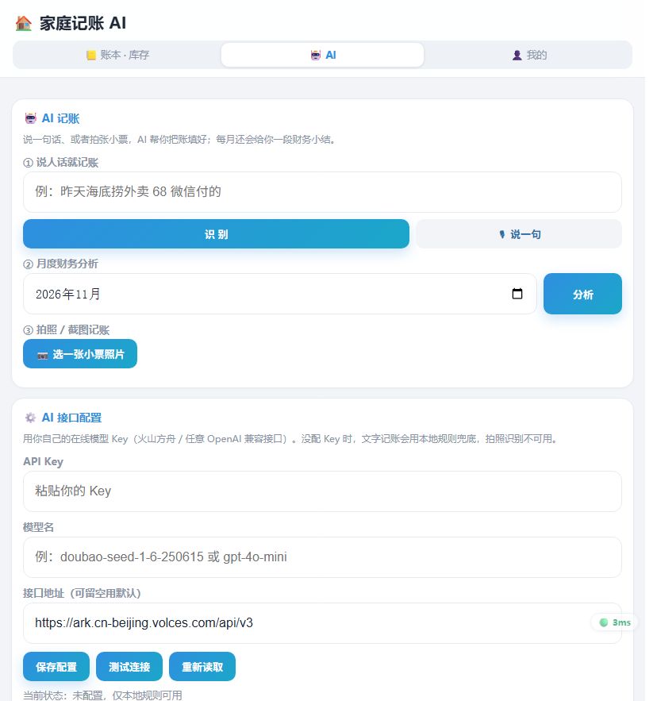
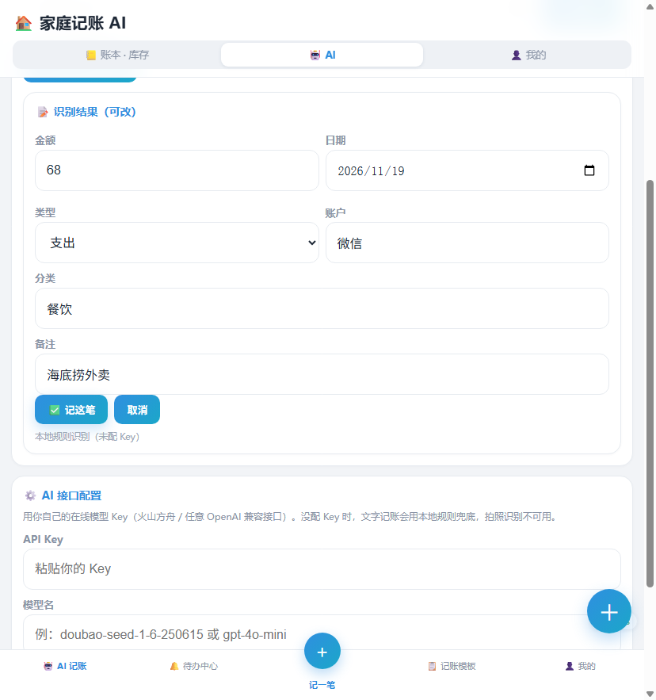

# 家庭记账 AI（fambookai）

跑在飞牛 fnOS 上的轻量家庭账本 + AI 记账。说一句话就记账、拍张小票自动入账、每月给一段财务小结。数据全部存在本机应用数据目录，不上传任何服务器。

- 应用包名：`fambookai`
- 当前版本：`2.1.0`（fpk manifest 内版本号）
- 平台：`x86`（fnOS 0.9.0 及以上）
- 服务端口：`8813`（自带登录鉴权，未登录的页面跳登录、接口返回 401）
- 运行身份：应用专用账号 `fambookai`，非 root

## 功能

1. **账本**：收入 / 支出 / 转账三类，支持分类、账户（现金、微信、支付宝、银行卡、信用账户）、备注、按月筛选。
2. **说人话就记账**：输入「昨天海底捞外卖 68 微信付的」，自动解析金额、日期、分类、账户、备注，草稿可改后再入账。
   - 支持中文数字与小数：「二十七块五」→ 27.5
   - 支持相对日期：今天 / 昨天 / 前天 / N月N日
   - 支持商户与品类同义词：海底捞→餐饮·外出聚餐、加油→交通·加油、充话费→通讯·话费
   - 从「微信付的」「支付宝」「现金」等表述自动匹配账户
3. **拍照 / 截图记账**：选一张小票照片，识别商户、金额、日期，同样可改后再入账。
4. **月度财务分析**：收入、支出、结余、日均支出、环比上月、支出占比最高的类别，并给一句改进建议。

## 安装

1. 下载本仓库的 `fambookai.fpk`（或从 Releases 下载）。
2. 飞牛 NAS 桌面 →「应用中心」→ 右上角「手动安装」→ 选择该 `.fpk`。
3. 安装完成后打开桌面图标，第一次进入是**注册**页；注册的第一个账号自动成为管理员，注册成功后回到登录页登录。
4. 数据目录：`/vol1/@appdata/fambookai/data/fambook.db`（SQLite），随应用升级保留。

## AI 接口配置

- 进入「AI」页 → 「AI 接口配置」，填 API Key、模型名（如 `doubao-seed-1-6-250615`）、接口地址（默认 `https://ark.cn-beijing.volces.com/api/v3`，任何 OpenAI 兼容接口都行），点「测试连接」自检。
- **不填 Key 也能用**：文字记账自动降级为本地规则解析，月度分析用本地统计；拍照识别会明确提示不可用。
- Key 只保存在本机数据库（`ai_cfg` 表），不会上传到第三方；调用只发往你自己填的那个模型接口。

## 版本说明

### 2.1.0

- 重写口语记账解析：中文数字与小数、商户/品类同义词、支付方式映射账户
- 新增相对日期识别（今天 / 昨天 / 前天 / N月N日）
- 月度分析升级：记账天数、环比上月、支出占比、预算与信用负债提示
- 小票识别提示词收紧：金额只取实付/合计，分类限定在应用分类表内，看不清留空不编造
- 新增「🎙 说一句」语音输入、「测试连接」接口自检
- 修复空库时基础账户（现金/微信/支付宝/银行卡）未创建的问题

### 2.0.0

- 独立应用化：空库启动、自带登录/注册、数据目录改用应用私有目录、端口 8813
- 新增三项 AI 能力：口语记账、月度分析、拍照识别小票

## 注意事项

- 本包用官方 `fnpack 1.3.3` 以 `--nosign` 方式打包，属于本地安装包；未签名版本不用于对外分发审核。
- 源码为个人项目，保留所有权利，未经许可请勿商用。
- 应用只监听 `8813` 端口并提供页面与接口，接口均带登录鉴权；照片读取接口只允许访问应用自己的照片目录内的文件名。
